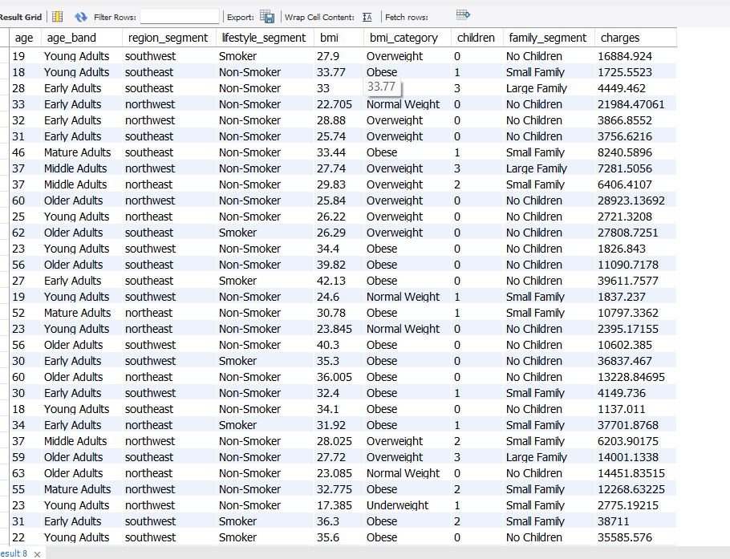
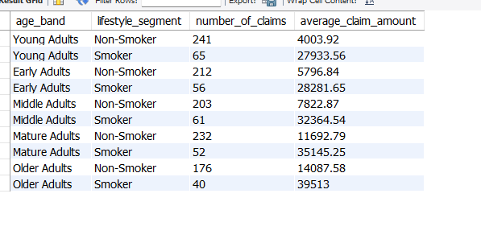
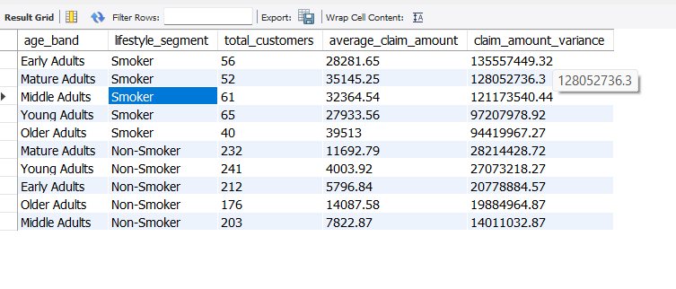
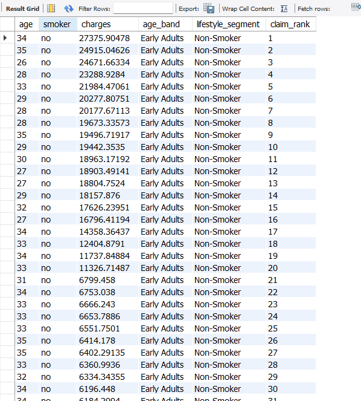
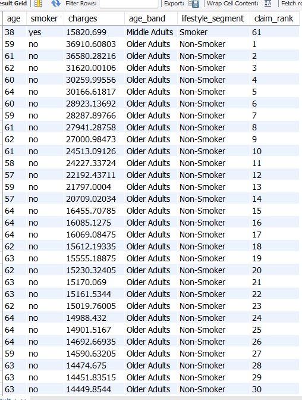
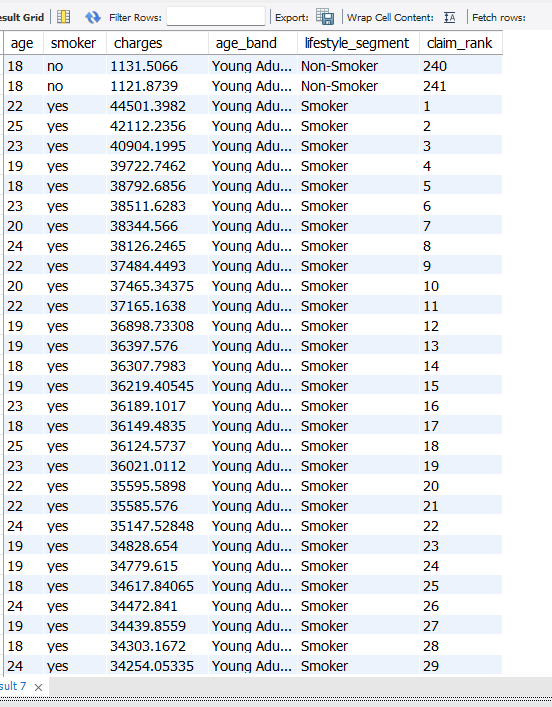
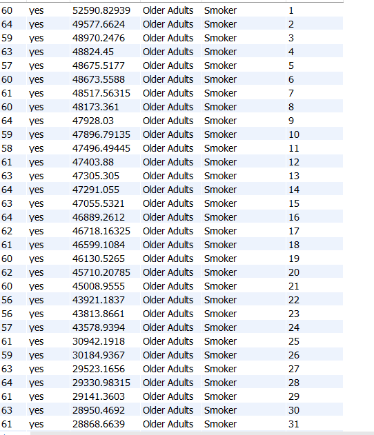
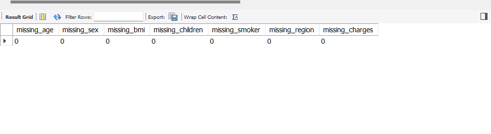

# Insurance Claims Risk Profiling

A MySQL analysis that segments insurance policyholders by age and smoking status, compares insurance charges across segments, measures charge variability, and ranks policyholders within each segment.

## Project Overview

The project uses the U.S. Health Insurance dataset to examine how insurance charges (`charges`) vary across customer segments. SQL queries perform the following analyses:

- Create age and lifestyle segments
- Compare average insurance charges by segment
- Compare segment averages with the population average
- Calculate charge variance within each segment
- Rank policyholders by charge within their segment

The SQL implementation uses MySQL 8 and window functions.

## Dataset

The source dataset is the **U.S. Health Insurance Dataset**, available from Kaggle:

https://www.kaggle.com/datasets/teertha/ushealthinsurancedataset

The repository includes a data source note at [`data/raw/.README.md`](data/raw/.README.md). The CSV itself is not stored in the repository.

## Database Schema

The schema in [`sql/schema/schema.sql`](sql/schema/schema.sql) creates an InnoDB table named `insurance` in the `insurance_claims` database.

| Column | SQL type | Description |
|---|---|---|
| `age` | DOUBLE | Policyholder age |
| `sex` | VARCHAR(50) | Policyholder sex |
| `bmi` | DOUBLE | Body mass index |
| `children` | VARCHAR(50) | Number of children/dependants |
| `smoker` | VARCHAR(50) | Smoking status |
| `region` | VARCHAR(100) | Geographic region |
| `charges` | DOUBLE | Insurance charge |

## Repository Structure

```text
insurance-claims-risk-profiling/
├── data/
│   └── raw/
│       └── .README.md
├── images/
│   ├── Average_claim_amount_by_risk_segment.png
│   ├── amount_variance_by_segment_groups.png
│   ├── segment_average_claim_VS_population_average)_claim.png
│   ├── segment_categories.png
│   └── Ranking_within_segment_group*.png
├── sql/
│   ├── analysis/
│   │   ├── Average_claim_amount_by_risk_segment.sql
│   │   ├── Ranking_within_segment_group.sql
│   │   ├── amount_variance_by_segment_groups.sql
│   │   ├── segment_average_claim_VS_population_average_claim.sql
│   │   └── segment_categories.sql
│   └── schema/
│       └── schema.sql
└── README.md
```

## Segment Definitions

### Age bands

| Age | Segment |
|---|---|
| 18–25 | Young Adults |
| 26–35 | Early Adults |
| 36–45 | Middle Adults |
| 46–55 | Mature Adults |
| 56 or older | Older Adults |

The age-band classification is repeated across the analysis queries.

### Lifestyle segment

- `smoker = 'yes'` → Smoker
- `smoker = 'no'` → Non-Smoker

## SQL Analysis

### 1. Create customer segments

[`sql/analysis/segment_categories.sql`](sql/analysis/segment_categories.sql) assigns each policyholder an age band, region segment, lifestyle segment, BMI category, and family segment.

BMI categories are:

| BMI | Category |
|---|---|
| Below 18.5 | Underweight |
| 18.5 to below 25 | Normal Weight |
| 25 to below 30 | Overweight |
| 30 or above | Obese |

Family categories are:

- `children = 0`: No Children
- `children = 1–2`: Small Family
- `children >= 3`: Large Family



### 2. Compare average charges by segment

[`sql/analysis/Average_claim_amount_by_risk_segment.sql`](sql/analysis/Average_claim_amount_by_risk_segment.sql) calculates the customer count and average charge for each age-band and smoking-status combination.



### 3. Compare segments with the population average

[`sql/analysis/segment_average_claim_VS_population_average_claim.sql`](sql/analysis/segment_average_claim_VS_population_average_claim.sql) uses a CTE to calculate the overall average charge and joins it with each segment average.

_claim.png)

### 4. Measure variance

[`sql/analysis/amount_variance_by_segment_groups.sql`](sql/analysis/amount_variance_by_segment_groups.sql) calculates the count, average, and variance of charges for every age-and-smoking segment. The query orders segments by variance in descending order.



### 5. Rank policyholders within segments

[`sql/analysis/Ranking_within_segment_group.sql`](sql/analysis/Ranking_within_segment_group.sql) uses `RANK()` over age bands and smoking status:

```sql
RANK() OVER (
    PARTITION BY
        CASE
            WHEN age BETWEEN 18 AND 25 THEN 'Young Adults'
            WHEN age BETWEEN 26 AND 35 THEN 'Early Adults'
            WHEN age BETWEEN 36 AND 45 THEN 'Middle Adults'
            WHEN age BETWEEN 46 AND 55 THEN 'Mature Adults'
            ELSE 'Older Adults'
        END,
        smoker
    ORDER BY charges DESC
) AS claim_rank
```

The query restarts the ranking for every combination of age band and smoking status.









## Key Findings

### Insurance Risk Profile by Customer Segment

The analysis examined insurance claim amounts across different age groups and smoking-status segments to identify differences in average costs and claim variability.

The results show that **Older Adult Smokers have the highest average claim amount of 39,513.00**, followed by Mature Adult Smokers at 35,145.25. In contrast, Young Adult Non-Smokers have the lowest average claim amount of 4,003.92. Across all five age groups, smokers consistently have higher average insurance charges than non-smokers.

When compared with the overall population average of **13,270.42**, six segments record above-average charges, including all five smoking segments and Older Adult Non-Smokers. The remaining four non-smoking segments have below-average charges.

The variance analysis also revealed that Early Adult Smokers have the highest claim amount variance of approximately 135.56 million. This indicates that insurance charges within this segment are more widely spread, making their costs less predictable compared with the other segments.

Overall, the findings suggest that smoking status and age groups are useful factors for distinguishing customer segments with different insurance cost patterns. Older Adult Smokers represent the segment with the highest average charges, while Early Adult Smokers show the greatest variability in charges. These insights can help insurers identify segments that may require closer attention when assessing insurance costs and managing financial risk.

### 1. Older Adult Smokers – Highest Average Insurance Charges

This segment has the highest average insurance charge of **39,513.00**, significantly above the overall population average of 13,270.42. This suggests that this group represents a higher-cost segment in the dataset. Insurers may consider closer evaluation of pricing assumptions and financial exposure for this group.

### 2. Early Adult Smokers – Highest Claim Variability

Early Adult Smokers have the highest claim amount variance of approximately **135.56 million**, alongside an average charge of 28,281.65. The high variance indicates that insurance costs within this segment are less consistent, making it important to examine the factors contributing to the wide differences in charges.

### 3. Mature Adult Smokers – High Average Charges and Variability

This segment records an average insurance charge of **35,145.25** and the second-highest variance of approximately **128.05 million**. The combination of high average charges and substantial variability makes this group another important segment for closer underwriting assessment.

### Overall Recommendation

These three segments warrant closer attention because they combine relatively high insurance costs with significant differences in claim variability. Older Adult Smokers stand out for their high average charges, while Early Adult Smokers and Mature Adult Smokers demonstrate considerable unpredictability in insurance costs.

Insurers could use these findings to guide further risk assessment, pricing reviews and investigation of the factors driving differences in insurance charges.

### Risk Profiling Logic

The risk profiling analysis segments policyholders using age bands and smoking status to identify differences in insurance charges across customer groups. Average charges for each segment are compared with the overall population average of 13,270.42 to identify groups with relatively higher or lower costs. Variance is also calculated to assess how predictable charges are within each segment, while window functions rank individual policyholders by their charges within their respective segments.

The findings highlight Older Adult Smokers as the segment with the highest average charges, Early Adult Smokers as having the highest charge variability, and Mature Adult Smokers as another group with high average charges and variability. These segments warrant closer underwriting attention when reviewing pricing and risk exposure. The analysis provides a data-driven basis for further assessment rather than assuming that every individual within a segment has the same level of risk.

## Missing Values

The repository includes a missing-values screenshot:



## Getting Started

### Requirements

- MySQL 8.0 or later
- Access to the U.S. Health Insurance dataset
- A MySQL client such as MySQL Workbench

### Setup

1. Download the dataset from Kaggle.
2. Create a database named `insurance_claims`.
3. Run [`sql/schema/schema.sql`](sql/schema/schema.sql) to create the `insurance` table.
4. Import the dataset into the `insurance` table.
5. Run the SQL files in `sql/analysis/` to reproduce the segment summaries and rankings.

> The repository does not include an automated import script or configuration file. Column mapping and import settings must be set in the MySQL client when loading the external dataset.

## Limitations

- The analysis is descriptive and uses the available dataset fields.
- Findings describe differences in this dataset and do not establish causation.
- The repository does not provide a predictive insurance-risk model.
- The CSV dataset is external and is not included in this repository.
